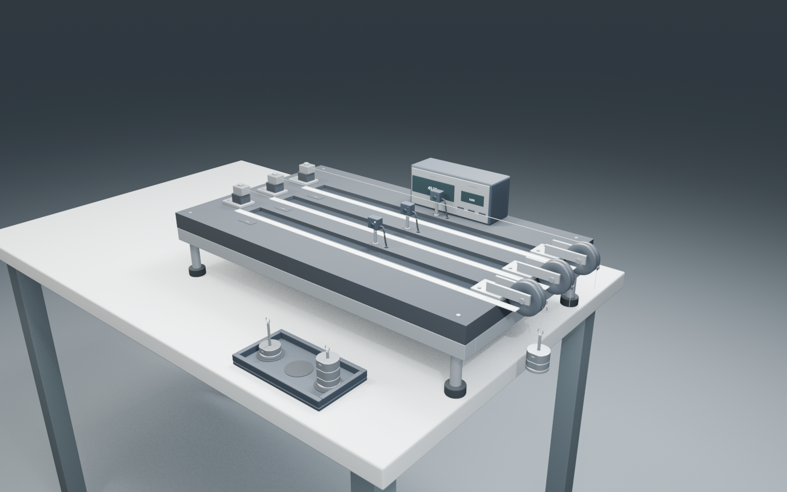
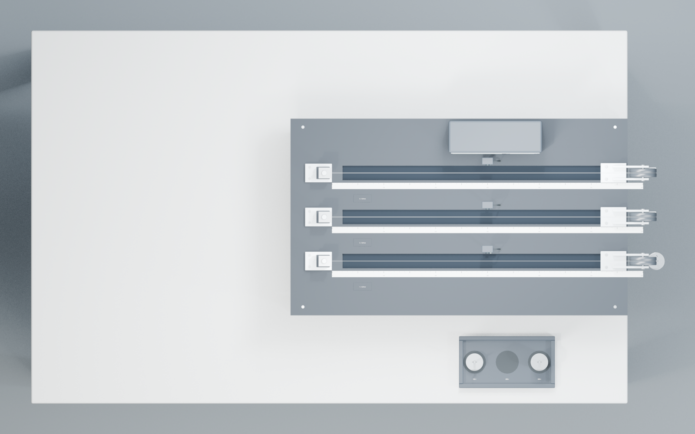
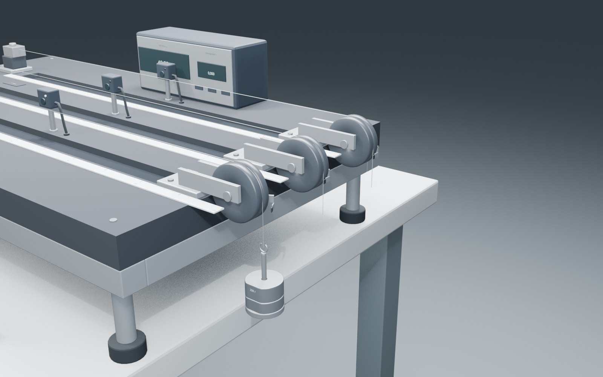

# Стоячие волны на струне

Русскоязычная виртуальная лаборатория для сравнения частот колебаний стальных струн при разных диаметрах и натяжениях. В готовой лаборатории преподаватель сможет открыть сайт по ссылке, выбрать струну и груз, оттянуть струну и измерить частоту виртуальным датчиком или вручную с секундомером.

## Текущее состояние

Этап 02 завершён. Предварительная сцена собрана и проверена в Blender. На обсуждение вынесен вариант A — открытый алюминиевый стенд с тремя параллельными каналами, зажимами, роликами, лотком на три груза и корпусом приборов. На контрольных кадрах груз 200 г висит на передней струне S1, два других стоят в лотке. Показания на дисплеях статические. Интерактивность, приборы, график, таблица, звук и публикация сайта запланированы на следующие этапы.

[Вид спереди](assets/blender/previews/02-front.png) · [Крепления](assets/blender/previews/04-clamps.png) · [Приборы](assets/blender/previews/06-measurement.png) · [Эскизы вариантов](docs/installation-concepts.svg)

## Как открыть модель

1. Скачайте [prototype.blend](assets/blender/prototype.blend) через кнопку скачивания на странице файла GitHub или клонируйте репозиторий по [инструкции для участников](CONTRIBUTING.md).
2. Откройте скачанный файл в Blender 5.3 через меню **File → Open**. Сцена содержит геометрию, материалы и свет. Для просмотра отдельные шрифты, текстуры и Blender MCP не нужны.
3. В Outliner разверните коллекцию `08_STUDIO` для выбора камер. Нажмите `Numpad 0` для перехода к активной камере. Чтобы воспроизвести сцену из кода и проверить экспорт, используйте [команды из передачи проекта](docs/HANDOFF.md#воспроизведение-и-проверка).

## Параметры опыта

| Параметр | Значение |
|---|---|
| Пролёт между неподвижными опорами | 0,600 м |
| Материал и плотность | Сталь, 7850 кг/м³ |
| Диаметры струн | 0,3, 0,4 и 0,5 мм |
| Массы грузов вместе с держателем | 100, 200 и 300 г |
| Максимальное оттягивание | 10 мм |
| Коэффициент затухания амплитуды | 2 с⁻¹, предварительное значение |

Груз задаёт натяжение `T ≈ mg` при `g = 9,81 м/с²`. В основной моде концы струны неподвижны, пучность находится в середине, а частота идеальной струны равна `f₁ = √(T/μ)/(2L)`, где `μ = ρπd²/4`. Для девяти сочетаний расчёт даёт 21,02–60,69 Гц. Датчик по проекту измеряет пять полных периодов, а секундомер в режиме «Замедление ×40» показывает время модели. [Формулы и таблица частот](docs/physics.md)

## Стек и структура

Для моделирования используются Blender и Blender MCP. Для приложения согласованы React, TypeScript, Vite, Three.js, React Three Fiber и Drei. Планируются Vitest, Playwright и публикация на Vercel.

| Путь | Содержимое |
|---|---|
| [assets/blender/](assets/blender/) | Исходная сцена, скрипты сборки, проверки и рендера |
| [assets/blender/previews/](assets/blender/previews/) | Шесть контрольных ракурсов |
| [docs/](docs/) | Проектная документация, эскизы и отчёт о проверке |
| [AGENTS.md](AGENTS.md), [CLAUDE.md](CLAUDE.md) | Общие требования и подключение их в Claude Code |
| [plan.md](plan.md), [CONTRIBUTING.md](CONTRIBUTING.md) | Этапы и порядок работы в команде |

Начните с [передачи проекта](docs/HANDOFF.md) и [правил командной работы](CONTRIBUTING.md). Для обсуждения конструкции используйте [отчёт о прототипе и координаты](docs/prototype.md), [спецификацию установки](docs/installation.md) и [контракт GLB](docs/blender-glb.md). [Указатель документации](docs/README.md)

## Ограничения и ближайшие задачи

- Тонкая струна может теряться в общем виде, а строго спереди пролёты накладываются друг на друга. Согласовать ракурс измерения и подсветку активного канала.
- Задний датчик частично перекрывает корпус прибора в боковом ракурсе. Проверить читаемость по поднятому ракурсу и согласовать панель показаний для сайта.
- Последние 30 мм шкалы выступают за край панели. Согласовать опору шкалы и повторную проверку зазора в канавке ролика после детализации.
- Пробный экспорт показывает 180 примитивов на экземплярах мешей. Для рабочих GLB оптимизировать статические детали и проверить в браузере целевой бюджет около 80 вызовов отрисовки стенда.

Ближайшая контрольная точка — согласование предварительной сцены. После него команда сможет деталировать стенд и начать реализацию физики и браузерной сцены по [плану](plan.md).
