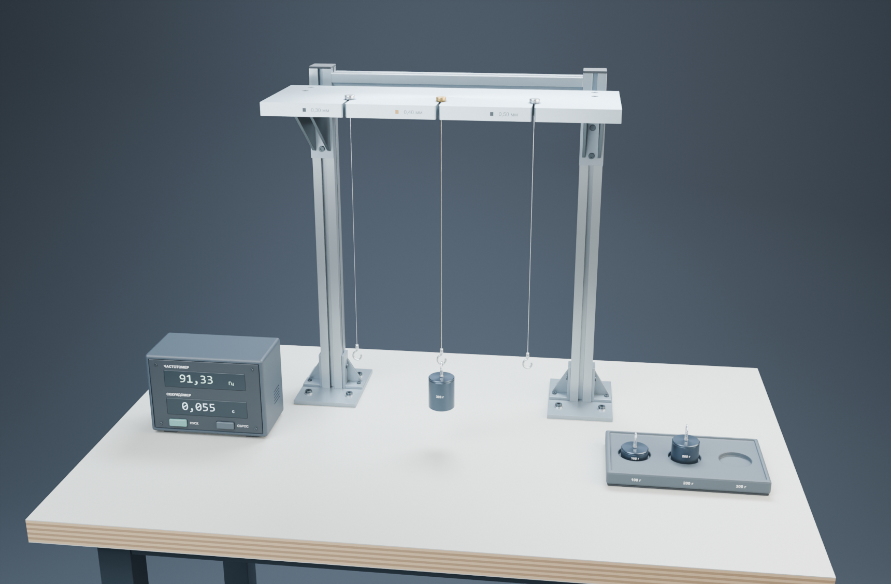
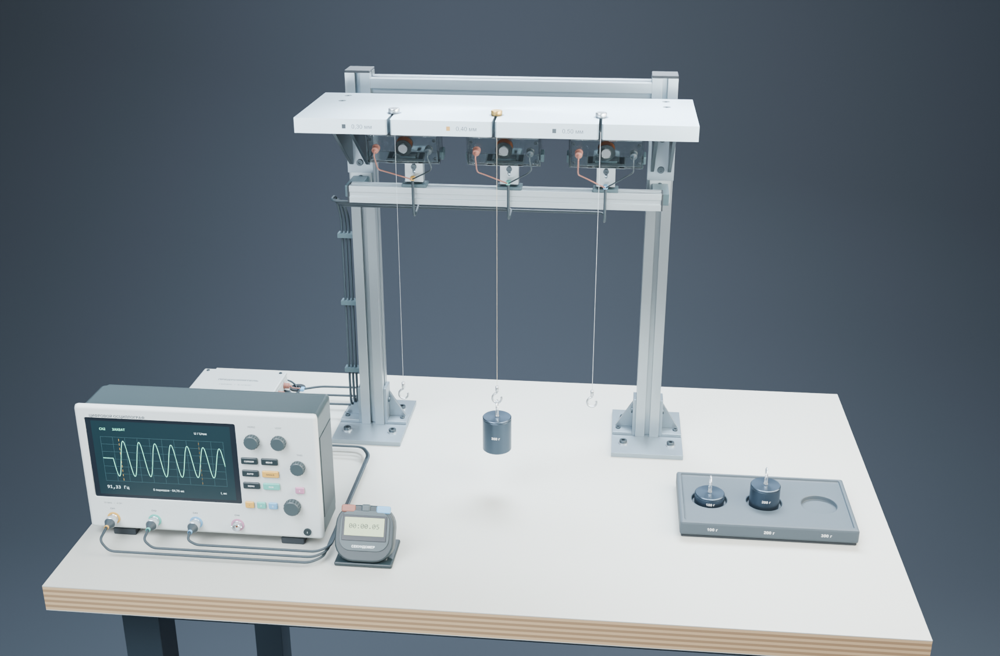

# Вертикальная установка Blender V3 и V3.1

Модели предназначены для согласования облика виртуальной лаборатории «Стоячие волны на струне». Три вертикальные струны проходят через прорези верхней доски. Широкие наконечники опираются на доску, а грузы подвешиваются непосредственно на нижние крючки. Лоток расположен справа, приборы — слева.

| Версия | Что в сцене | Материалы |
|---|---|---|
| V3 | Верстак, рама с консолями, три струны с подвесами, лоток, грузы и общий корпус частотомера и секундомера | [Модель](laboratory_v3.blend) · [Отчёт и 9 ракурсов](../../../docs/3d-development/laboratory-v3.md) · [248 объектов](../../../docs/3d-development/laboratory-v3-objects.md) |
| V3.1 | На базе V3 собран измерительный вариант B. Три магнитные головки по мотивам Eisco PH0731, трёхканальный предусилитель, осциллограф класса Rigol DHO804, отдельный секундомер и кабели | [Модель](laboratory_v3_1.blend) · [Отчёт и 9 ракурсов](../../../docs/3d-development/laboratory-v3-1.md) · [714 объектов](../../../docs/3d-development/laboratory-v3-1-objects.md) |

**V3.1 — предварительная модель для согласования. Интеграция GLB в существующий сайт запланирована на следующий этап.** Показания в Blender статические. Осциллограмма V3.1 показывает условное напряжение, а текущий график сайта показывает смещение струны в миллиметрах.





[Датчик крупным планом](renders/v3-1/05_pickup_detail.png) · [Измерительная система V3.1](renders/v3-1/09_measurement_system.png) · [Эскиз частотомера](references/variant-a.svg) · [Эскиз осциллографа](references/variant-b.svg) ([PNG](references/variant-b.png)) · [Крепление датчиков](references/pickup-layout.svg)

## Открытие и воспроизведение

Откройте ссылку на модель в GitHub, скачайте файл через **Download raw file** и откройте его в Blender 5.3 через **File → Open**. Камеры находятся в коллекции `08_STUDIO`. Готовые сцены содержат материалы и надписи в виде сеток, поэтому для просмотра достаточно файла Blender.

Для пересборки клонируйте репозиторий и выполните команды из его корня. Пересборка и вывод проверок идут в отдельную папку. Без `LAB_V3_OUTPUT_DIR` генераторы пишут рядом с сохранёнными моделями.

```sh
export LAB_V3_OUTPUT_DIR="$(mktemp -d)"
blender --background --factory-startup --disable-autoexec --python-exit-code 1 --python assets/blender/v3/scripts/build_laboratory_v3.py
blender --background --factory-startup --disable-autoexec "$LAB_V3_OUTPUT_DIR/laboratory_v3.blend" --python-exit-code 1 --python assets/blender/v3/scripts/build_laboratory_v3_1.py
blender --background --factory-startup --disable-autoexec "$LAB_V3_OUTPUT_DIR/laboratory_v3.blend" --python-exit-code 1 --python assets/blender/v3/scripts/verify_laboratory_v3.py -- --glb --inventory "$LAB_V3_OUTPUT_DIR/v3-objects.md"
blender --background --factory-startup --disable-autoexec "$LAB_V3_OUTPUT_DIR/laboratory_v3_1.blend" --python-exit-code 1 --python assets/blender/v3/scripts/verify_laboratory_v3_1.py -- --inventory "$LAB_V3_OUTPUT_DIR/v3-1-objects.md"
blender --background --factory-startup --disable-autoexec "$LAB_V3_OUTPUT_DIR/laboratory_v3_1.blend" --python-exit-code 1 --python assets/blender/v3/scripts/render_laboratory_v3.py -- --view 01_overview
```

В PowerShell вместо строки `export` задайте `$env:LAB_V3_OUTPUT_DIR = Join-Path ([IO.Path]::GetTempPath()) ("lab-v3-" + [guid]::NewGuid())` и в остальных строках используйте `$env:LAB_V3_OUTPUT_DIR`. В Blender можно использовать полный путь к исполняемому файлу, если команда `blender` недоступна в PATH. Скрипты ищут кириллические шрифты в стандартных системных папках. Для воспроизведения исходных надписей используются Arial, Arial Bold и Consolas. При необходимости укажите свои установленные шрифты через `LAB_V3_FONT`, `LAB_V3_BOLD` и `LAB_V3_MONO`. Удалите аргументы `-- --view 01_overview`, чтобы отрисовать все камеры.

## Параметры и проверки

- Рабочий пролёт каждой струны — **300 мм**, диаметры — **0,3 / 0,4 / 0,5 мм**, плотность стали — **7800 кг/м³**, массы — **100 / 200 / 300 г**. Верх закреплён, нижний крючок свободен относительно стойки. Расчётный диапазон частот — **42,18–121,77 Гц**. [Параметры опыта](../../../AGENTS.md)
- V3 проверена на девяти сочетаниях грузов и крючков. Пробный GLB сохраняет три отдельных груза, пролёты по 0,300 м и именованные привязки. [Геометрия и пробный экспорт](../../../docs/3d-development/laboratory-v3.md)
- Для V3.1 проверен поперечный ход до 23 мм во всех направлениях. Консервативный запас до датчиков и их креплений — **1,789 мм**, до проводки и соединителей — **11,349 мм**. Проверены экранные привязки и независимость кабельных маршрутов. [Методика и ограничения](../../../docs/3d-development/laboratory-v3-1.md#зазоры-и-доступность)
- Обе сохранённые сцены открылись в Blender 5.3 с заводскими настройками. Веб-сцена, физический модуль и тесты соответствуют командному master. При проверке прошли 25 тестов Vitest, сборка Vite и 4 сценария Playwright, включая прямой щипок во всех девяти сочетаниях. [Аудит сайта](../../../docs/3d-development/site-audit.md)

## Дальнейшая работа

Подтвердить на физическом образце размеры и чувствительность головок, монтажные зазоры, уровень сигнала тонкой струны, сетевой фон, усиление, полосу и запись одного щипка. Пробный экспорт V3 ещё требует оптимизации перед веб-загрузкой. После согласования V3.1 подготовить GLB и проверить загрузку, читаемость, захват мышью и касанием и все девять сочетаний в браузере.

В [документации вертикальной установки](../../../docs/3d-development/README.md) собраны спецификация, план, контракт GLB, исследования оборудования и ссылки на первоисточники. Эскизы и рендеры изготовлены для проекта. Сторонние фотографии и паспорта представлены ссылками на университеты и изготовителей.
